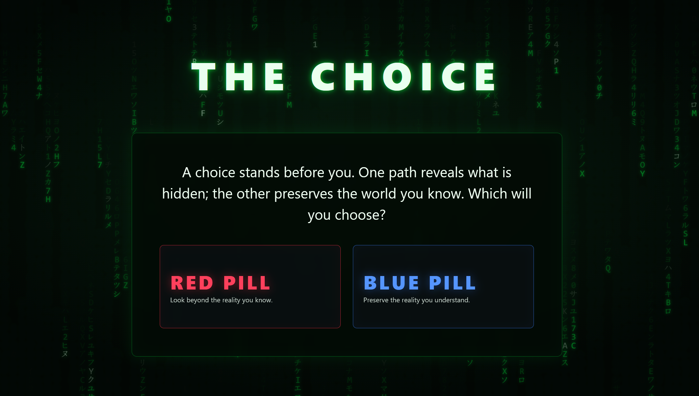
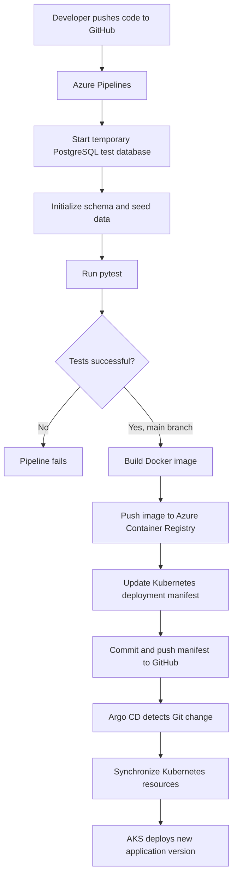

# The Choice — Azure CI/CD & GitOps



An interactive, branching-choice web application built with Python, Flask and PostgreSQL. The application can be run locally in two ways: directly with Python and PostgreSQL, or as a containerized stack with Compose. The project also includes an Azure Kubernetes Service (AKS) deployment used to demonstrate CI/CD and GitOps.

This is a hands-on DevOps portfolio project demonstrating automated testing, containerization, continuous integration, container image publishing and GitOps-based Kubernetes delivery.

## Overview

The Choice presents visitors with a sequence of decisions. Each answer determines the next question, and the completed answer path determines the prophecy revealed at the end of the journey.

The application uses anonymous visitor sessions and stores questions, options, journeys, responses and prophecy mappings in PostgreSQL.

Beyond application development, the project demonstrates an automated cloud-native delivery workflow. Azure Pipelines validates changes, builds and publishes a container image, and updates the Kubernetes deployment manifest in GitHub. Argo CD monitors the repository and synchronizes the desired configuration to AKS when that cluster is running.

## Features

### Application

- Branching question-and-answer journeys.
- Anonymous visitor sessions.
- PostgreSQL persistence for questions, options and responses.
- Path-based prophecy selection.
- Flask application using the application factory pattern.
- Matrix-inspired animated background using JavaScript Canvas.
- Automated application tests using pytest.

### DevOps and infrastructure

- Automated CI pipeline using Azure Pipelines.
- PostgreSQL service container for isolated integration testing.
- Docker-based application containerization.
- Non-root application execution inside the container.
- Automated Docker image builds and pushes to Azure Container Registry (ACR).
- Unique container image tags based on Azure Pipeline Build IDs.
- Azure authentication using Workload Identity Federation.
- Automated Kubernetes manifest updates through GitHub.
- GitOps deployment management using Argo CD.
- Kubernetes application Deployment and PostgreSQL StatefulSet on AKS.
- Persistent PostgreSQL storage using Azure managed disks.
- Kubernetes ConfigMaps and Secrets for application configuration.

## Architecture

GitHub is the source of truth for the application code and Kubernetes deployment configuration. The repository supports two local ways to run the application. Separately, the maintainer's Azure environment demonstrates automated cloud delivery.

### Automated CI/CD and GitOps workflow



### Pipeline stages

#### 1. Continuous Integration — Test

Azure Pipelines validates pull requests targeting `main` and runs the configured pipeline for changes to `main`.

The test job:

- Starts a temporary PostgreSQL 16 container dedicated to the pipeline run.
- Installs Python 3.12 and the application development dependencies.
- Initializes the test database using `db/schema.sql`.
- Populates the test database using `db/seed.py`.
- Executes the pytest test suite.

The pipeline does not use the persistent PostgreSQL database running in AKS for these tests. The test database is temporary and isolated from the application databases used by local development and the Azure deployment.

The container image build runs only after successful tests on `main`. Pull-request validation does not publish images or deploy changes.

#### 2. Container build and publishing

After successful testing on `main`, Azure Pipelines:

- Authenticates to Azure using an Azure Resource Manager service connection with Workload Identity Federation.
- Builds the application image using the project `Dockerfile`.
- Pushes the resulting image to Azure Container Registry.
- Uses the Azure Pipeline Build ID as a unique image tag.

Image naming convention:

```text
<your-acr-name>.azurecr.io/the-choice:<BUILD_ID>
```

#### 3. Automated GitOps update

After publishing the image, the pipeline:

- Updates the image reference in `k8s/app/deployment.yaml`.
- Commits the modified manifest to the GitHub repository.
- Uses a `[skip ci]` commit message to prevent an unnecessary pipeline loop.

GitHub therefore remains the source of truth for the desired Kubernetes deployment state.

#### 4. Argo CD synchronization

Argo CD runs inside the AKS cluster and monitors the GitHub repository. When a new image tag is committed, Argo CD detects the manifest change and synchronizes the desired configuration with AKS.

Argo CD can only perform this synchronization while the AKS cluster is running and reachable. If the maintainer stops AKS to reduce compute costs, the local application options remain available, but the cloud-hosted deployment is not running and will not receive updates until the cluster is started again.

#### 5. Kubernetes deployment

Azure Kubernetes Service runs the application and its PostgreSQL database when the maintainer's cluster is active.

Kubernetes manages the application Deployment, internal Service discovery, PostgreSQL StatefulSet and persistent database storage. The database uses a PersistentVolumeClaim backed by Azure managed storage.

## Technology stack

| Area | Technology |
|---|---|
| Backend | Python 3.12, Flask |
| Database | PostgreSQL 16 |
| Database driver | Psycopg 3 |
| Frontend | HTML, CSS, JavaScript |
| Testing | pytest |
| Version control | Git, GitHub |
| CI/CD | Azure Pipelines |
| Containerization | Docker |
| Local container runtime | Podman |
| Container registry | Azure Container Registry |
| Container orchestration | Kubernetes |
| Cloud Kubernetes | Azure Kubernetes Service |
| GitOps | Argo CD |
| Infrastructure authentication | Microsoft Entra ID, Workload Identity Federation |
| Deployment configuration | Kubernetes YAML, Kustomize |

## Project structure

```text
The_Choice_Azure_CICD/
│
├── app/
│   ├── routes/
│   ├── services/
│   ├── static/
│   ├── templates/
│   ├── __init__.py
│   └── db.py
│
├── db/
│   ├── schema.sql
│   └── seed.py
│
├── docs/
│   └── images/
│       └── image.png
│
├── tests/
│
├── k8s/
│   ├── app/
│   │   ├── configmap.yaml
│   │   ├── deployment.yaml
│   │   └── service.yaml
│   │
│   ├── jobs/
│   │   └── seed-job.yaml
│   │
│   ├── postgres/
│   │   ├── pvc.yaml
│   │   ├── service.yaml
│   │   └── statefulset.yaml
│   │
│   └── namespace.yaml
│
├── .dockerignore
├── .gitignore
├── Architecture.md
├── Questions.md
├── Dockerfile
├── compose.yaml
├── azure-pipelines.yml
├── kustomization.yaml
├── requirements.txt
├── requirements-dev.txt
└── run.py
```

## Run locally

The repository provides two local runtime options. Both use a local PostgreSQL database, but **they are separate database instances**. Data created in one option is not automatically shared with the other.

### Option 1 — Run with Python and local PostgreSQL

This option runs Flask directly in your Python environment. PostgreSQL must be installed and running separately.

#### Prerequisites

- Python 3.12.
- PostgreSQL 16.
- Git.

#### 1. Clone the repository

```bash
git clone https://github.com/intontis/The_Choice_Azure_CICD.git
cd The_Choice_Azure_CICD
```

#### 2. Create and activate a virtual environment

```bash
python3 -m venv .venv
source .venv/bin/activate
```

#### 3. Install dependencies

```bash
python -m pip install --upgrade pip
python -m pip install -r requirements-dev.txt
```

#### 4. Configure environment variables

Create a local `.env` file in the project root:

```dotenv
FLASK_SECRET_KEY=replace_with_a_secure_random_value

DB_HOST=127.0.0.1
DB_PORT=5432
DB_NAME=the_choice
DB_USER=the_choice_app
DB_PASSWORD=your_local_database_password
```

Create the PostgreSQL database and application user using your local PostgreSQL administration method. Ensure the credentials and database name match the values in `.env`.

Never commit `.env` or other credentials to GitHub.

#### 5. Initialize the database

Ensure PostgreSQL is running. Load the local environment variables into the current shell:

```bash
set -a
source .env
set +a
```

Apply the database schema:

```bash
PGPASSWORD="$DB_PASSWORD" psql \
  -h "$DB_HOST" \
  -p "$DB_PORT" \
  -U "$DB_USER" \
  -d "$DB_NAME" \
  -v ON_ERROR_STOP=1 \
  -f db/schema.sql
```

Populate the database with the initial application data:

```bash
PGHOST="$DB_HOST" \
PGPORT="$DB_PORT" \
PGDATABASE="$DB_NAME" \
PGUSER="$DB_USER" \
PGPASSWORD="$DB_PASSWORD" \
python db/seed.py
```

The seed script initializes the database content. Its conflict-handling behaviour determines whether running it again updates existing records or leaves them unchanged. Review `db/seed.py` before rerunning it against a database that already contains data.

#### 6. Run the application

```bash
python run.py
```

Open the application at:

**http://127.0.0.1:5000**

Stop the development server with `Ctrl+C` in the terminal where it is running.

### Option 2 — Run with Podman Compose or Docker Compose

This option runs Flask and PostgreSQL as separate containers. It avoids installing the application's Python dependencies and PostgreSQL server directly on the host, although Podman or Docker and Compose support are required.

#### Prerequisites

- Podman with Compose support, or Docker with Docker Compose.
- Git.

#### 1. Clone the repository

```bash
git clone https://github.com/intontis/The_Choice_Azure_CICD.git
cd The_Choice_Azure_CICD
```

#### 2. Configure environment variables

Create a local `.env` file in the project root. Use the variables and values expected by `compose.yaml` for the PostgreSQL service and Flask application. For example:

```dotenv
FLASK_SECRET_KEY=replace_with_a_secure_random_value

DB_NAME=the_choice
DB_USER=the_choice_app
DB_PASSWORD=your_local_database_password
```

Never commit `.env` or other credentials to GitHub.

#### 3. Start PostgreSQL

With Podman Compose:

```bash
podman compose up -d db
```

With Docker Compose, use:

```bash
docker compose up -d db
```

#### 4. Populate the database

With Podman Compose:

```bash
podman compose run --rm web python db/seed.py
```

With Docker Compose:

```bash
docker compose run --rm web python db/seed.py
```

The Compose configuration must make the schema available to the database and the seed process. Review `compose.yaml` if you change service names or database configuration.

#### 5. Start the application

With Podman Compose:

```bash
podman compose up -d web
```

With Docker Compose:

```bash
docker compose up -d web
```

Check the running containers:

```bash
podman compose ps
```

For Docker Compose, use `docker compose ps`.

Open the application at:

**http://127.0.0.1:8000**

#### 6. Stop the containers

Stop and remove the Compose containers while retaining the named PostgreSQL volume:

```bash
podman compose down
```

For Docker Compose, use `docker compose down`.

The named database volume is retained when using `down` without `-v`, so the containerized PostgreSQL data can be used again when the stack is restarted. To remove the containers and the local PostgreSQL volume, use `podman compose down -v` (or `docker compose down -v`). **This permanently deletes the data stored in that Compose volume.**

## Database and data persistence

The two local options use different PostgreSQL instances:

- **Python + local PostgreSQL:** data is stored in the PostgreSQL instance configured in the local `.env` file. Its persistence and backups are managed by that local PostgreSQL installation.
- **Compose:** data is stored in the PostgreSQL container's named volume defined by `compose.yaml`. `compose down` retains that volume; `compose down -v` removes it.

The Azure PostgreSQL database is a third, separate database used by the maintainer's AKS deployment. It is not shared with either local option. The temporary PostgreSQL service used by Azure Pipelines is a fourth, isolated test database and is discarded after the pipeline job.

The seed script is used to initialize database content. Changing `db/seed.py` in Git does not directly modify an existing database. To change existing records, the seed logic must explicitly support updating them, or a separate database update/migration must be run against the intended database. Always back up data before making destructive database changes.

## Running tests

Run the test suite from the project root with the virtual environment activated:

```bash
python -m pytest -q
```

The database integration tests require PostgreSQL to be available with the expected test database schema and credentials. Azure Pipelines performs database initialization and seeding automatically before executing the test suite.

## Cloud deployment architecture — maintainer environment

The repository also contains Kubernetes manifests used for the project's Azure deployment. This is a demonstration of the DevOps delivery architecture, not a third public run option or a permanently hosted public demo.

The Kubernetes configuration is maintained in GitHub and deployed through Argo CD to the maintainer's AKS cluster. The `k8s/` directory contains:

| Resource | Purpose |
|---|---|
| Namespace | Isolates application resources in `the-choice`. |
| ConfigMap | Supplies non-sensitive application configuration. |
| Secret | Stores the database password and Flask secret key; values are provisioned separately from Git. |
| Deployment | Runs the Flask application container. |
| Service | Exposes the application internally within Kubernetes. |
| StatefulSet | Runs PostgreSQL. |
| PersistentVolumeClaim | Provides persistent database storage. |
| Seed Job | Initializes application data during Argo CD synchronization. |

Sensitive Kubernetes configuration is provisioned separately from Git and is not stored in the repository.

Argo CD runs inside AKS, monitors the repository and synchronizes Kubernetes resources when the cluster is running. The maintainer may stop the AKS cluster to reduce compute costs. When it is stopped, the cloud deployment is unavailable and Argo CD cannot synchronize changes until the cluster is started again. The local Python and Compose options remain independent and can still be used.

The AKS environment is maintained separately from the public repository and may be stopped when it is not being used. No public application URL is provided as part of this repository. The two supported ways for visitors to run and explore the application are the local Python/PostgreSQL setup and the local Compose setup described above.

To deploy this project to another Kubernetes cluster, a user must provide their own cluster, container registry, credentials, Kubernetes Secrets and Argo CD configuration. The repository does not provide a hosted Azure environment to people who clone it.

## Azure CI/CD configuration

The Azure DevOps pipeline and cloud resources belong to the maintainer's environment. Cloning the repository and running either local option does **not** require an Azure subscription, Azure DevOps service connection, GitHub Personal Access Token or access to the maintainer's AKS cluster.

For the maintainer's automated deployment workflow:

- Azure Pipelines uses an Azure Resource Manager service connection with Workload Identity Federation to authenticate to Azure.
- The pipeline uses a GitHub token stored as the secret pipeline variable `GITHUB_TOKEN` to push the image-tag manifest update to the repository.
- The GitHub token must remain valid and have the required repository write permissions. If it expires or is revoked, the automated manifest-update step must be repaired or the token renewed. This does not affect either local run option.
- AKS has permission to pull application images from ACR.
- Azure Pipelines has registry-scoped permissions for image publishing.
- Argo CD performs Kubernetes synchronization while AKS is running.

Do not place tokens, passwords, private keys or service-connection credentials in the repository.

## Azure infrastructure

The maintainer's deployment uses the following Azure resource types:

| Resource | Purpose |
|---|---|
| Resource Group | Groups related project resources. |
| AKS Cluster | Runs the Kubernetes application and PostgreSQL workloads. |
| Container Registry | Stores versioned `the-choice` application images. |
| Kubernetes Namespace | Separates application resources in `the-choice`. |
| Managed Disk | Provides persistent storage for PostgreSQL. |

The Azure Container Registry uses the Basic tier in the recorded implementation. Actual resource names, subscription identifiers and credentials are deliberately not required by the local setup instructions.

## Secrets and configuration

The project keeps sensitive configuration outside source control:

- Local application configuration is stored in `.env`, which is excluded by `.gitignore`.
- Azure Pipelines stores the GitHub token as a secret variable named `GITHUB_TOKEN`.
- Kubernetes database credentials and the Flask secret key are stored in a Kubernetes Secret named `the-choice-secrets`.
- Azure Pipelines authenticates to Azure using Workload Identity Federation rather than a stored Azure client secret.

Never commit passwords, access tokens, private keys or production secrets to GitHub. Use placeholder values in documentation and keep real credentials in local environment files or the relevant secret-management service.

## Project status

The main application and automated Azure delivery workflow have been implemented and verified in the maintainer's environment.

The project demonstrates:

- Automated application testing.
- Container image building.
- Image publishing to Azure Container Registry.
- Automated GitOps manifest updates.
- Argo CD synchronization.
- Successful application rollout on Azure Kubernetes Service.
- Two documented local ways to run the application: directly with Python and with Compose.

The Azure deployment is a portfolio demonstration and may not be running continuously. The local run instructions are the supported way for repository visitors to explore the application without depending on the maintainer's cloud resources.

---

**Repository:** [github.com/intontis/The_Choice_Azure_CICD](https://github.com/intontis/The_Choice_Azure_CICD)

**Technologies:** Python · Flask · PostgreSQL · Docker · Podman · Azure Pipelines · ACR · Kubernetes · AKS · Argo CD · GitOps
