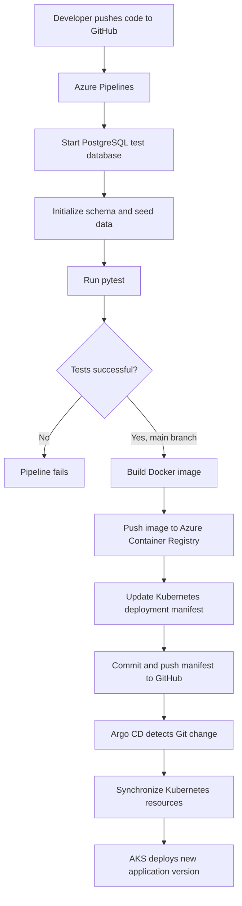

# The Choice — Azure CI/CD & GitOps


An interactive, branching-choice web application built with Python, Flask and PostgreSQL, deployed to Azure Kubernetes Service (AKS) using Azure Pipelines, Azure Container Registry (ACR) and Argo CD.

This project is a hands-on DevOps portfolio project demonstrating automated testing, containerization, continuous integration, continuous delivery and GitOps-based Kubernetes deployments.

## Overview

The Choice presents visitors with a sequence of decisions. Each answer determines the next question, and the completed answer path determines the prophecy revealed at the end of the journey.

The application uses anonymous visitor sessions and stores questions, options, journeys, responses and prophecy mappings in PostgreSQL.

Beyond application development, the project demonstrates an automated cloud-native delivery workflow. Every successful push to the `main` branch triggers automated testing, container image creation, registry publishing and a GitOps manifest update. Argo CD detects the updated configuration and deploys the new application version to AKS.

## Features

### Application

- Branching question-and-answer journeys.
- Anonymous visitor sessions.
- PostgreSQL persistence for questions, options and responses.
- Path-based prophecy selection.
- Flask application using the application factory pattern.
- Matrix-inspired animated background using JavaScript Canvas.
- Automated application tests using pytest.

### DevOps and Infrastructure

- Automated CI pipeline using Azure Pipelines.
- PostgreSQL service container for isolated integration testing.
- Docker-based application containerization.
- Non-root application execution inside the container.
- Automated Docker image builds and pushes to Azure Container Registry.
- Unique container image tags based on Azure Pipeline Build IDs.
- Azure authentication using Workload Identity Federation.
- Automated Kubernetes manifest updates through GitHub.
- GitOps deployment management using Argo CD.
- Kubernetes application deployment and PostgreSQL StatefulSet on AKS.
- Persistent PostgreSQL storage using Azure managed disks.
- Kubernetes ConfigMaps and Secrets for application configuration.

## Architecture

The project uses GitHub as the source of truth for both application code and Kubernetes deployment configuration.

### Automated CI/CD and GitOps workflow



### Pipeline stages

**1. Continuous Integration — Test**

Azure Pipelines runs on GitHub changes targeting `main` and validates pull requests.

The test job:

- Starts a temporary PostgreSQL 16 container.
- Installs Python 3.12 and application development dependencies.
- Initializes the database using `db/schema.sql`.
- Populates the database using `db/seed.py`.
- Executes the pytest test suite.

The container image build is performed only after successful tests on the `main` branch. Pull-request validation does not publish images or deploy changes.

**2. Container Build and Publishing**

After successful testing, Azure Pipelines:

- Authenticates to Azure using an Azure Resource Manager service connection with Workload Identity Federation.
- Builds the application image using the project Dockerfile.
- Pushes the resulting image to Azure Container Registry.
- Uses the Azure Pipeline Build ID as a unique image tag.

Image naming convention:

```text
<your-acr-name>.azurecr.io/the-choice:<BUILD_ID>
```

**3. Automated GitOps Update**

After publishing the image, the pipeline:

- Updates the image reference in `k8s/app/deployment.yaml`.
- Commits the modified manifest to the GitHub repository.
- Uses a `[skip ci]` commit message to prevent an unnecessary pipeline loop.

GitHub therefore remains the source of truth for the desired Kubernetes deployment state.

**4. Argo CD Synchronization**

Argo CD monitors the GitHub repository and automatically detects changes to the Kubernetes manifests.

When a new image tag is committed, Argo CD synchronizes the desired configuration with the AKS cluster.

**5. Kubernetes Deployment**

Azure Kubernetes Service runs the application and its PostgreSQL database.

Kubernetes manages application replicas, container health checks, internal service discovery and persistent database storage.

## Technology Stack

| Area | Technology |
|---|---|
| Backend | Python 3.12, Flask |
| Database | PostgreSQL 16 |
| Database driver | Psycopg 3 |
| Frontend | HTML, CSS, JavaScript |
| Testing | pytest |
| Version control | Git, GitHub |
| CI/CD | Azure Pipelines |
| Containerization | Docker |
| Local container runtime | Podman |
| Container registry | Azure Container Registry |
| Container orchestration | Kubernetes |
| Cloud Kubernetes | Azure Kubernetes Service |
| GitOps | Argo CD |
| Infrastructure authentication | Microsoft Entra ID, Workload Identity Federation |
| Deployment configuration | Kubernetes YAML, Kustomize |

## Project Structure

```text
The_Choice_Azure_CICD/
│
├── app/
│   ├── routes/
│   ├── services/
│   ├── static/
│   ├── templates/
│   ├── __init__.py
│   └── db.py
│
├── db/
│   ├── schema.sql
│   └── seed.py
│
├── tests/
│
├── k8s/
│   ├── app/
│   │   ├── configmap.yaml
│   │   ├── deployment.yaml
│   │   └── service.yaml
│   │
│   ├── jobs/
│   │   └── seed-job.yaml
│   │
│   ├── postgres/
│   │   ├── pvc.yaml
│   │   ├── service.yaml
│   │   └── statefulset.yaml
│   │
│   └── namespace.yaml
│
├── .dockerignore
├── .gitignore
├── Architecture.md
├── Questions.md
├── Dockerfile
├── compose.yaml
├── azure-pipelines.yml
├── kustomization.yaml
├── requirements.txt
├── requirements-dev.txt
└── run.py
```

## Local Development

### Prerequisites

- Python 3.12
- PostgreSQL 16
- Git

### 1. Clone the repository

```bash
git clone https://github.com/intontis/The_Choice_Azure_CICD.git

cd The_Choice_Azure_CICD
```

### 2. Create and activate a virtual environment

```bash
python3 -m venv .venv

source .venv/bin/activate
```

### 3. Install dependencies

```bash
python -m pip install --upgrade pip

python -m pip install -r requirements-dev.txt
```

### 4. Configure environment variables

Create a local `.env` file in the project root:

```dotenv
FLASK_SECRET_KEY=replace_with_a_secure_random_value

DB_HOST=127.0.0.1
DB_PORT=5432
DB_NAME=the_choice
DB_USER=the_choice_app
DB_PASSWORD=your_local_database_password
```

Never commit `.env` or other credentials to GitHub.

### 5. Initialize the database

Ensure PostgreSQL is running and that the application database and user exist.

Load the local environment variables:

```bash
set -a
source .env
set +a
```

Apply the database schema:

```bash
PGPASSWORD="$DB_PASSWORD" psql \
  -h "$DB_HOST" \
  -p "$DB_PORT" \
  -U "$DB_USER" \
  -d "$DB_NAME" \
  -v ON_ERROR_STOP=1 \
  -f db/schema.sql
```

Populate the database:

```bash
PGHOST="$DB_HOST" \
PGPORT="$DB_PORT" \
PGDATABASE="$DB_NAME" \
PGUSER="$DB_USER" \
PGPASSWORD="$DB_PASSWORD" \
python db/seed.py
```

### 6. Run the application

```bash
python run.py
```

Open the application at:

http://127.0.0.1:5000

## Local Containerized Development

The project also includes a Compose configuration for running Flask and PostgreSQL in containers.

The configuration works with Podman Compose and Docker Compose.

Ensure your `.env` file contains the required database credentials and Flask secret key.

Start PostgreSQL:

```bash
podman compose up -d db
```

Populate the database:

```bash
podman compose run --rm web python db/seed.py
```

Start the application:

```bash
podman compose up -d web
```

Check the running containers:

```bash
podman compose ps
```

Open the application at:

http://127.0.0.1:8000

Stop the containers without deleting the database volume:

```bash
podman compose down
```

To remove the containers and the local PostgreSQL volume, use `podman compose down -v`. This permanently removes the local containerized database data.

## Running Tests

Run the test suite from the project root:

```bash
python -m pytest -q
```

The database integration tests require PostgreSQL to be available with the expected test database schema and credentials.

Azure Pipelines performs the database initialization and seeding automatically before executing the test suite.

## Kubernetes Deployment

The Kubernetes configuration is maintained in the GitHub repository and deployed through Argo CD.

The `k8s/` directory contains:

| Resource | Purpose |
|---|---|
| Namespace | Isolates application resources in `the-choice`. |
| ConfigMap | Supplies non-sensitive application database configuration. |
| Secret | Stores database password and Flask secret key. |
| Deployment | Runs the Flask application container. |
| Service | Exposes the application internally within Kubernetes. |
| StatefulSet | Runs PostgreSQL. |
| PersistentVolumeClaim | Provides persistent database storage. |
| Seed Job | Initializes application data during Argo CD synchronization. |

Sensitive Kubernetes configuration is provisioned separately from Git and is not stored in the repository.

Argo CD monitors the repository root and synchronizes the Kubernetes resources to AKS when the desired configuration changes.

For local access to the deployed application, use:

```bash
kubectl port-forward -n the-choice svc/the-choice 8081:80
```

Then open:

http://localhost:8081

## Azure Infrastructure

The project uses the following Azure resources:

| Resource | Configuration |
|---|---|
| Resource Group | Azure Resource Group |
| AKS Cluster | Azure Kubernetes Service |
| Container Registry | Azure Container Registry |
| Container Registry Tier | Basic |
| Kubernetes Namespace | `the-choice` |
| Container Image | `the-choice` |

The Azure DevOps service connection uses Workload Identity Federation instead of a stored Azure client secret.

AKS is granted permission to pull application images from ACR. Azure Pipelines has registry-scoped permissions for image publishing, while Argo CD manages Kubernetes synchronization.

## Secrets and Configuration

The project keeps sensitive configuration outside source control.

- Local application configuration is stored in `.env`, which is excluded by `.gitignore`.
- Azure Pipelines stores the GitHub Personal Access Token as a secret variable named `GITHUB_TOKEN`.
- Kubernetes database credentials and the Flask secret key are stored in a Kubernetes Secret named `the-choice-secrets`.
- Azure Pipelines authenticates to Azure using Workload Identity Federation.

Never commit passwords, access tokens, private keys or production secrets to GitHub.

## Project Status

The main application and automated deployment workflow are implemented and verified.

The project demonstrates a complete automated delivery chain:

- Automated application testing.
- Container image building.
- Image publishing to Azure Container Registry.
- Automated GitOps manifest updates.
- Argo CD synchronization.
- Successful application rollout on Azure Kubernetes Service.

The resulting workflow allows a successful application change pushed to the `main` branch to progress through testing, image publishing and Kubernetes deployment without manually executing build or deployment commands.

---

**Repository:** [github.com/intontis/The_Choice_Azure_CICD](https://github.com/intontis/The_Choice_Azure_CICD)

**Technologies:** Python · Flask · PostgreSQL · Docker · Podman · Azure Pipelines · ACR · Kubernetes · AKS · Argo CD · GitOps
